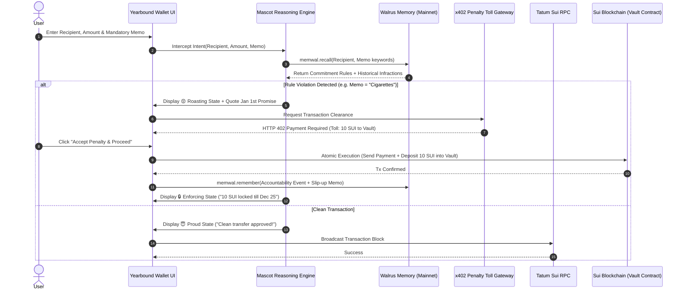

# 📜 YEARBOUND: THE DEFINITIVE PRODUCT BIBLE
**Project Codename:** Yearbound  
**Track:** Consumer Finance Apps (Tatum × Walrus "Total Recall" Hackathon)  
**Target:** 1st Place Track ($500) + Best Walrus Memory ($500) + Best Tatum AI Builder ($500) + Best Agent Payments ($500) = **$2,000 Sweep**  
**Engineering Contract:** Every promise in this document corresponds 1:1 with verifiable code in the repository.

---

## 1. PRODUCT ESSENCE & CORE DIFFERENTIATION

### 1.1 What We Are NOT Building
* We are **NOT** building a generic AI chatbot where users type into an empty text prompt.
* We are **NOT** building a passive personal finance dashboard that only shows charts of money already spent.
* We are **NOT** building an honor-system habit tracker where users manually tick checkboxes.

### 1.2 What We ARE Building
**Yearbound is an Accountable Consumer Finance App & Enforcing Wallet.** 
It couples an in-app payment engine with an opinionated, **Duolingo-style mascot companion ("Wally")** whose brain is powered by **Walrus Memory** and whose eyes are powered by **Tatum Sui RPC**.

When a user spends or transfers money inside the app:
1. Every transaction requires a **Mandatory Transaction Note / Memo**.
2. At the exact **Point of Payment**, the mascot intercepts and cross-references the transaction against New Year's promises stored in Walrus Memory.
3. If a commitment is broken (e.g. buying cigarettes, sending money to a forbidden ex-partner, or exceeding spending caps), the mascot **taunts the user using their own past words** and **forces an x402 penalty toll** into a time-locked Sui vault before the payment can clear.
4. On **December 24–25 (Christmas)**, the vault unlocks, returning 100% of the accumulated funds to the user as a financial gift from their disciplined past self.

---

## 2. THE MASCOT ("WALLY THE ENFORCER"): BEHAVIORAL ENGAGEMENT MODEL

The mascot is the living personality of the app. It prevents the product from feeling like an intimidating bank or a sterile spreadsheet.

### 2.1 Mascot Visual State Machine
The mascot has 5 distinct visual and behavioral states:

```
┌────────────────────────────────────────────────────────────────────────┐
│                        MASCOT STATE MACHINE                            │
├────────────────────────────────────────────────────────────────────────┤
│ 1. 😇 Proud / Festive  → Triggered when savings goals are met or        │
│                          clean streaks are maintained.                 │
│                          "30 days without an unapproved transfer!"     │
│                                                                        │
│ 2. 🧐 Suspicious       → Triggered when a transaction note contains     │
│                          questionable keywords or amount exceeds $50.  │
│                          "What exactly is this 'late night snack'?"    │
│                                                                        │
│ 3. 😏 Smug / Roasting   → Triggered upon rule violation. Quotes the     │
│                          user's own January words back to them.        │
│                          "Remember Jan 2? 'I will NEVER send funds to  │
│                          0xSarah again.' Yet here we are."             │
│                                                                        │
│ 4. 😤 Enforcing Lock   → Triggered during x402 vault penalty deposit.  │
│                          Plays lock animation & updates vault total.   │
│                          "10 SUI locked in Christmas Vault. No takesies│
│                          backsies until December 25."                  │
│                                                                        │
│ 5. 🎅 Santa / Payoff   → Triggered on Dec 24–25. Unlocks the smart     │
│                          contract and delivers the Year-End Audit.     │
│                          "You survived. Here's your $450 back."        │
└────────────────────────────────────────────────────────────────────────┘
```

### 2.2 Memory-Driven Dialogue (Not Scripted Quotes)
The mascot never repeats generic motivational platitudes. Every intervention is generated using **Walrus Memory recall**, injecting:
* The exact timestamp when the user made the promise.
* The specific words and rationale the user gave in January.
* Historical frequency of slip-ups (e.g., *"This is your 3rd time trying this on a Friday"*).

---

## 3. COMPONENT 1: JANUARY ONBOARDING (PACT FORMATION)

The user begins the commitment year through a structured 4-step onboarding wizard.

### 3.1 What We Collect & Store
The app captures four concrete financial resolution categories:

| Resolution Category | Real-World Example | How the App Enforces It |
| :--- | :--- | :--- |
| **1. Forbidden Recipients** | "Never send money to my ex (`0xSarah...`)" or "No casino/betting contracts" | Exact recipient address matching on outbound transfers. |
| **2. Addictions & Prohibited Categories** | "No cigarettes", "No alcohol", "No fast food", "No Steam sales" | Keyword & semantic matching on the **Mandatory Transaction Memo**. |
| **3. Spending Caps** | "No single discretionary transaction over 50 SUI" | Numerical threshold comparison at transaction submission. |
| **4. Income & Inflow Targets** | "I want to make 4,000 SUI / month from freelancing" | Tatum RPC monitors wallet incoming transaction blocks. |

### 3.2 Penalty & Escrow Setup
For each commitment, the user defines:
* **The Penalty Amount:** Fixed SUI amount (e.g. 10 SUI per violation).
* **Escalation Rules:** Whether repeated violations within 30 days trigger an escalating penalty (e.g. +5 SUI per repeat offense).
* **Agreed Exceptions:** Strict exemptions (e.g. *"Medical emergencies"*, *"Rent to 0xLandlord"*).

### 3.3 Walrus Genesis Storage
At the completion of onboarding, the agent commits a batch of structured `commitment_rule` blobs to **Walrus Mainnet**:
```json
{
  "type": "commitment_rule",
  "commitment_id": "cmt_jan2026_01",
  "title": "Strict Ex-Partner Payment Blacklist",
  "category": "forbidden_recipient",
  "target_address": "0x3b89...ex_partner",
  "penalty_amount_sui": 15,
  "escalation_step_sui": 5,
  "user_verbatim_quote": "I swear to never send her a dime again. If I do, take my money.",
  "created_at": "2026-01-01T12:00:00Z",
  "status": "active"
}
```

---

## 4. COMPONENT 2: THE ENFORCING WALLET & IN-APP PAYMENT FLOW

Yearbound is an active payment tool, not a spectator. Users initiate transfers and payments directly through the app.



### 4.1 Mandatory Transaction Memos (The Semantic Anchor)
Why transaction memos?
* In decentralized finance, transfer recipients are often opaque hex addresses.
* Requiring a memo (e.g. "dinner", "cigs", "groceries", "transfer to coworker") anchors the real-world semantic purpose to the on-chain action.
* If a user writes "cigs" or "vape" or leaves a suspicious field, the mascot cross-references it against Walrus Memory. If they try to circumvent with gibberish (e.g. "asdf"), the mascot rejects the transfer: *"Explain what this transaction is for before I sign it."*

---

## 5. COMPONENT 3: x402 PENALTY TOLL PROTOCOL

### 5.1 How x402 is Structurally Used
We do not fake x402 with a generic function call. The penalty mechanism is a **real HTTP-native micropayment gateway**:

1. **The Challenge (`402 Payment Required`):**
   When the app detects a broken pact, the internal transfer service refuses to broadcast the transaction and returns a standard HTTP 402 challenge:
   ```json
   {
     "status": "payment_required",
     "payment": {
       "scheme": "exact",
       "network": "sui",
       "currency": "SUI",
       "amount_sui": 10,
       "destination": "0xVault_Christmas_Escrow_Object_ID",
       "description": "Violation Penalty: Prohibited tobacco purchase",
       "nonce": "yb_x402_1730551200_9b1a"
     }
   }
   ```
2. **The Signature:**
   The user's client signs the payment authorization for the penalty fee.
3. **The Settlement:**
   The app bundles the penalty deposit into the Sui transaction via a Programmable Transaction Block (PTB) or relays it through the x402 settlement endpoint, locking the SUI into the Move Vault.

---

## 6. COMPONENT 4: THE SUI MOVE CHRISTMAS ESCROW VAULT

### 6.1 Strict Smart Contract Immutability
To ensure the funds are genuinely locked away and impossible for the user to retrieve prematurely:

1. **No Early Exit:** The Move smart contract (`contracts/yearbound/sources/vault.move`) contains **zero** emergency withdrawal methods, admin keys, or backdoor escape hatches.
2. **Time-Lock Enforcement:** The withdrawal function explicitly checks the Sui network clock:
   ```move
   assert!(clock::timestamp_ms(clock) >= vault.unlock_timestamp_ms, EVaultStillLocked);
   ```
3. **Unlock Date:** Pre-configured during vault creation to **December 25, 00:00:00 UTC** of the commitment year.
4. **Ownership:** Only the user's Sui address can trigger `withdraw()`. The agent cannot steal or redirect the funds; it can only *deposit* into the vault.

---

## 7. COMPONENT 5: TATUM SUI RPC & DATA INTELLIGENCE LAYER

Tatum is the agent's real-time sensory network on the blockchain.

### 7.1 Active Responsibilities
| Task | Tatum API / RPC Method | Frequency |
| :--- | :--- | :--- |
| **Income Target Tracking** | `suix_queryTransactionBlocks` (Filter: `ToAddress`) | Daily check of incoming SUI/stablecoin funds to measure progress toward "Make $4,000/mo". |
| **Wallet Balance Auditing** | `suix_getAllBalances` | Queried on app launch and pre-transaction check. |
| **Vault State Inspection** | `sui_getObject` (Vault Object ID) | Real-time tracking of locked penalty SUI. |
| **Transaction Execution** | `sui_executeTransactionBlock` | Relaying approved outbound transfers. |

---

## 8. COMPONENT 6: WALRUS MEMORY 4-LAYER COGNITIVE BRAIN

Walrus Memory is the persistent behavioral cortex. It ensures the mascot gets sharper, more personal, and more context-aware over the 12 months.

```
┌────────────────────────────────────────────────────────────────────────┐
│                     WALRUS 4-LAYER MEMORY GRAPH                        │
├────────────────────────────────────────────────────────────────────────┤
│ Layer 1: Genesis Pacts (Jan 1)                                         │
│   • Core rules, blacklisted addresses, spending limits, exact quotes   │
│                                                                        │
│ Layer 2: Transaction & Accountability Log (Continuous)                 │
│   • Every payment memo, time of day, amount, approved or penalized     │
│   • Exact excuses captured: "I had a stressful day at the office"     │
│                                                                        │
│ Layer 3: Behavioral Pattern Synthesis (Every 5 Infractions)            │
│   • Synthesized habits: "User's impulse transfers spike after 10 PM"   │
│   • "User attempts to send funds to forbidden targets after payday"    │
│                                                                        │
│ Layer 4: Escalation & Dynamic Interventions                            │
│   • Mascot references past excuses: "You said work was stressful last   │
│     time too. That excuse didn't work in March, it won't work now."    │
│   • Enforces pre-agreed penalty step increases for repeat violations.  │
└────────────────────────────────────────────────────────────────────────┘
```

---

## 9. COMPONENT 7: THE CHRISTMAS UNLOCK (DECEMBER 24–25)

On December 24–25, Yearbound transitions from Enforcer to Celebrant.

1. **The Annual Reflection Audit:**
   The mascot synthesizes all 4 layers of Walrus Memory to output the user's **Yearbound Discipline Report**:
   * Total transactions evaluated.
   * Total penalties intercepted and locked.
   * Behavioral patterns that improved (e.g. *"Late night impulse spending reduced by 72% between March and November"*).
   * Exact quote of the hardest moment overcome.
2. **The Fund Release:**
   The UI presents the **Unlock Christmas Gift** action. One click invokes `vault::withdraw`, returning 100% of the accumulated SUI to the user's primary wallet.

---

## 10. HACKATHON RUBRIC DEFENSE & BOUNTY MAPPING

| Category | Weight | How Yearbound Wins |
| :--- | :---: | :--- |
| **Walrus & Tatum Integration** | **30%** | • Walrus Mainnet stores all 4 cognitive memory layers ($\ge 10$ live memories).<br>• Tatum RPC powers wallet monitoring, income goal tracking, and vault state reads. |
| **Technical Quality** | **30%** | • Strict TypeScript Next.js 16 App Router architecture.<br>• Real Sui Move time-locked escrow contract with zero backdoors.<br>• Resilient fallback handling (`MemWalMock` + public RPC) and error recovery. |
| **Creativity & Novelty** | **20%** | • Duolingo-style behavioral mascot with persistent memory.<br>• Moves away from boring chatboxes to an enforcing wallet interface with mandatory memos. |
| **Presentation & Polish** | **20%** | • 2.5-min high-production video showing onboarding → transfer intercept → mascot roast → x402 vault deposit → Christmas unlock.<br>• Comprehensive README + published blog post. |

### Bonus Bounty Checklist
- [x] **Best Walrus Memory ($500):** Deepest learning loop where the mascot's roasts and interventions visibly evolve based on months of accumulated memory.
- [x] **Best Agent Payments ($500):** Genuine HTTP 402 challenge/response flow gating forbidden transactions and settling penalties on Sui.
- [x] **Best Tatum AI Builder ($500):** Scaffolding and full-stack Sui infrastructure completely integrated with Tatum RPCs.
