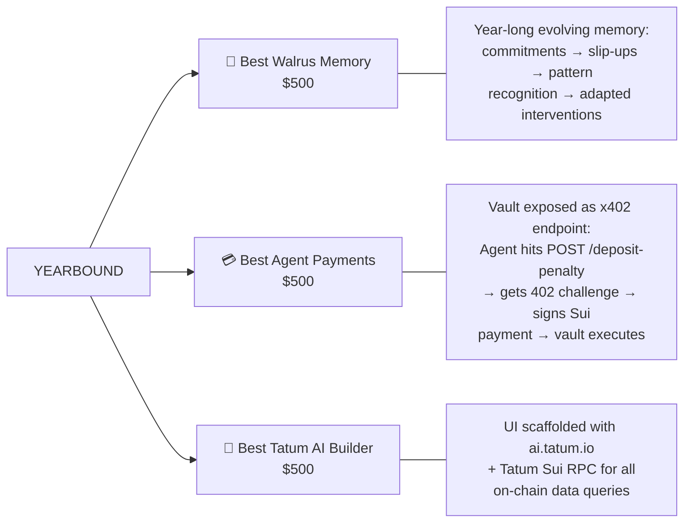
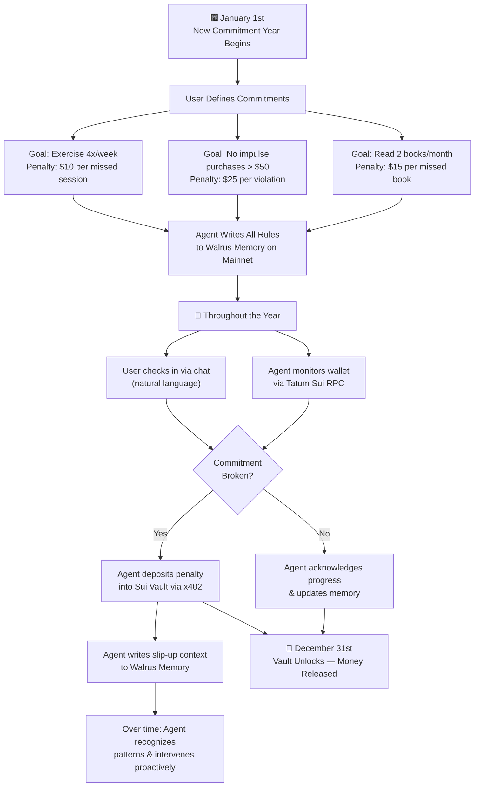
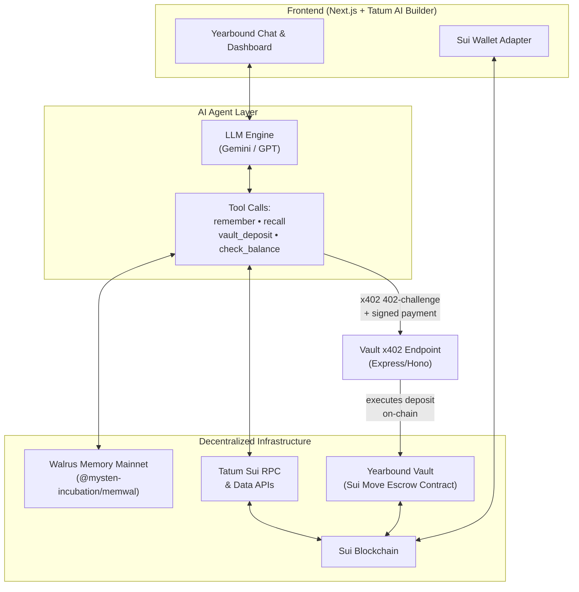
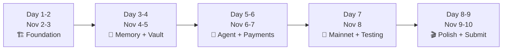

# 🏆 TOTAL RECALL HACKATHON: WINNING BLUEPRINT
## **YEARBOUND** — Make a Pact With Your Future Self

**Hackathon:** Tatum × Walrus Memory: "Total Recall"  
**Dates:** October 20 – November 10, 2026  
**Track:** Consumer Finance Apps  
**Prize Target:** 1st Place ($500) + Best Walrus Memory ($500) + Best Tatum AI Builder ($500) + Best Agent Payments ($500) = **Up to $2,000**

---

## ⚠️ MANDATORY ENGINEERING STANDARDS (ZERO AI-SLOP POLICY)
*This project is evaluated under rigorous technical review. Every commit and line of code must strictly adhere to:*

1. **Zero AI Slopism & Production-Grade Code Quality:**
   * No lazy placeholder comments (e.g. `// Add your logic here`, `// TODO: handle error`).
   * No dummy mock implementations disguised as real logic — every integration must be fully wired or explicitly handled with clean fallbacks.
   * Strict TypeScript (`strict: true`, no `any`, explicit interfaces/types for all domain models, props, and API payloads).
   * Robust error handling with graceful recovery, typed exceptions, and user-facing feedback.
2. **Intentional & Disciplined Commit Structure:**
   * Clean atomic git commits following Conventional Commits (`feat:`, `fix:`, `chore:`, `refactor:`, `docs:`, `test:`).
   * Each commit must represent a single logical, testable unit of progress with descriptive messages.
   * No monolithic "dump all files" commits.
3. **Modular & Cohesive Architecture:**
   * Clear separation of concerns:
     * `lib/walrus.ts`: Pure Walrus Memory SDK wrappers and job handlers.
     * `lib/tatum.ts`: Tatum Sui RPC calls, object queries, and indexer reads.
     * `lib/vault-x402.ts`: HTTP 402 challenge parser, payment verification, and Sui settlement.
     * `lib/agent-tools.ts`: Strongly typed Vercel AI SDK tool definitions.
     * `app/api/*`: Thin, resilient API route controllers.
     * `components/*`: Accessible, reusable UI components built with Tailwind CSS.
4. **Primary AI Engine:**
   * **Google Gemini (`@ai-sdk/google`)** powering the Vercel AI SDK streaming agent.

---

## 1. The Concept

> **Yearbound** is an AI-powered commitment and accountability app that helps people follow through on personal goals by attaching **financial consequences** to broken commitments.

Every January, users define their goals, personal rules, and the monetary penalties for breaking them. Throughout the year, when a commitment is broken, the corresponding amount is deposited into a **personal vault on Sui**, where it remains locked until December 31. The money still belongs to the user — it's just temporarily inaccessible.

The AI agent **remembers everything**: goals, rules, exceptions, slip-up patterns, emotional context, and recurring struggles. It uses this evolving memory to make accountability *proactive*, not reactive.

**The principle:** Breaking a commitment doesn't make you poorer — it makes your money temporarily inaccessible.

---

## 2. Judging Criteria: Score Maximization Matrix

| Category | Weight | What Judges Want | How Yearbound Delivers a Perfect Score |
| :--- | :---: | :--- | :--- |
| **Walrus & Tatum Integration** | **30%** | Meaningful, creative use of Walrus Memory on Mainnet + Tatum Sui RPC/Data APIs | • Year-long persistent memory of commitments, rules, exceptions, and behavioral patterns stored on Walrus Mainnet (≥10 memories).<br>• `memwal.recall()` drives every accountability check.<br>• Tatum Sui RPC queries vault balance, deposit history, and wallet state in real time. |
| **Technical Quality** | **30%** | Clean, bug-free code; solid Sui RPC integration; resilience | • TypeScript + Next.js + Sui Move vault contract.<br>• Modular agent architecture with clear separation: Memory Layer → Reasoning Layer → Payment Layer.<br>• Error-resilient `waitForRememberJob` handling and RPC fallbacks. |
| **Creativity & Novelty** | **20%** | Original idea; real consumer problem; deep "memory" theme | • No one else will combine accountability + financial escrow + evolving AI memory.<br>• The vault mechanic is novel: money isn't lost, it's locked.<br>• Memory isn't just storage — it shapes how the agent intervenes over months. |
| **Presentation** | **20%** | README, blog post, 2–3 min video demo, public GitHub | • Compelling demo arc: January setup → mid-year intervention → pattern recognition → December release.<br>• Clean blog post + polished video with voiceover. |

---

## 3. Bonus Bounties: The Triple Crown ($1,500 Extra)



### Why Yearbound Naturally Qualifies for All Three:

| Bounty | Requirement | Yearbound's Natural Fit |
| :--- | :--- | :--- |
| **Best Walrus Memory ($500)** | Deepest learning loop — memories visibly change agent behavior over time | The agent starts with raw commitments in January. By March it has learned *"User always breaks gym commitment on Fridays after long work weeks"* and intervenes preemptively. By June it adjusts its tone and timing based on accumulated context. The memory isn't static — it's a living behavioral model. |
| **Best Agent Payments ($500)** | x402 or MPP micropayments settled on Sui | **Vault-as-x402-gated-endpoint:** The penalty vault is exposed as an HTTP service. When the agent needs to deposit a penalty, it hits `POST /deposit-penalty` → receives a `402 Payment Required` challenge (with amount, currency, Sui destination) → autonomously signs and attaches the Sui payment via `X-PAYMENT` header → vault verifies and executes the deposit. This is legitimate x402 — the agent goes through a real HTTP payment protocol, not a raw `moveCall`. |
| **Best Tatum AI Builder ($500)** | Best shippable product using `ai.tatum.io` + Tatum RPCs | Scaffold the frontend and Sui integration flow via Tatum AI Builder. Use Tatum Sui RPC for all vault balance queries, deposit history, and wallet monitoring. |

---

## 4. Product Design: How Yearbound Works

### User Journey



### The 4 Memory Layers (Stored on Walrus Mainnet)

| Layer | What's Stored | Example Memory | How It Evolves |
| :--- | :--- | :--- | :--- |
| **1. Commitment Rules** | Goals, penalties, deadlines, exceptions | *"Exercise 4x/week. Penalty: \$10/miss. Exception: sick days with proof."* | Rules can be amended mid-year via conversation; agent tracks all amendments with timestamps. |
| **2. Accountability Log** | Every check-in, slip-up, and penalty event | *"March 14: User missed gym (3rd Friday miss in a row). \$10 deposited to vault. Total vault: \$85."* | Grows throughout the year — forms the raw data for pattern recognition. |
| **3. Behavioral Patterns** | Agent-derived insights from accumulated data | *"User consistently breaks gym commitment on Fridays after weeks with >3 late work nights."* | Agent periodically synthesizes new patterns from the accountability log and writes them as separate memories. |
| **4. Emotional Context & Reflections** | User's own words about why they slipped | *"User said: 'I was exhausted and stressed about the project deadline. I know I should have gone but I just couldn't.'"* | Agent references these during future interventions to show empathy and understanding rather than being a cold enforcer. |

### The Proactive Intervention Engine

This is how memory makes the agent **get smarter over time** (critical for the Best Walrus Memory bounty):

```
┌─────────────────────────────────────────────────────────────────────┐
│  MONTH 1 (Cold Start — No History)                                  │
│  Agent: "Did you go to the gym today?"                              │
│  User: "No, I skipped."                                             │
│  Agent: "Got it. $10 penalty deposited to your vault. Keep going!"  │
├─────────────────────────────────────────────────────────────────────┤
│  MONTH 3 (Pattern Recognized)                                       │
│  It's Thursday evening. Agent proactively messages:                  │
│  "Hey — I've noticed you tend to skip the gym on Fridays after      │
│   long work weeks. Tomorrow is Friday. Want to plan a shorter       │
│   30-min session instead of skipping entirely?"                     │
├─────────────────────────────────────────────────────────────────────┤
│  MONTH 6 (Deep Context)                                             │
│  User tries to make an impulse $120 purchase on Sui.                │
│  Agent (via Tatum RPC + Walrus recall):                             │
│  "Hold on — you set a $50 impulse limit in January. You also told  │
│   me in April that you regretted a similar purchase. That's a $25   │
│   penalty if you proceed. Your vault is at $210. Still want to?"    │
├─────────────────────────────────────────────────────────────────────┤
│  MONTH 12 (Year-End)                                                │
│  "🎉 Your commitment year is complete! Here's your recap:           │
│   • 47/52 gym weeks completed (90%)                                 │
│   • 3 impulse violations caught and penalized                       │
│   • $340 accumulated in vault — now unlocked and returned to you.   │
│   • Your biggest growth area: Friday discipline improved 60%        │
│     after we started the Thursday check-in in March."               │
└─────────────────────────────────────────────────────────────────────┘
```

---

## 5. Technical Architecture



### 5.1 x402 Vault Endpoint (The Agent Payments Bounty Play)

The vault deposit is gated behind a real x402 flow. The agent doesn't call the Move contract directly — it goes through an HTTP payment protocol.

```typescript
// vault-x402.ts — Express endpoint that gates deposits behind HTTP 402
import express from "express";
import { verifyX402Payment, settleSuiPayment } from "./x402-utils";

const app = express();
app.use(express.json());

// POST /deposit-penalty — x402-gated vault deposit
app.post("/deposit-penalty", async (req, res) => {
  const { amount, commitment_id, reason } = req.body;
  const paymentHeader = req.headers["x-payment"];

  // Step 1: If no payment attached, return 402 challenge
  if (!paymentHeader) {
    return res.status(402).json({
      status: "payment_required",
      payment: {
        scheme: "exact",
        network: "sui",
        currency: "SUI",
        amount: amount,  // penalty amount in SUI
        destination: process.env.VAULT_OBJECT_ID!,
        description: `Yearbound penalty: ${reason}`,
        expires: new Date(Date.now() + 5 * 60_000).toISOString(),
      },
    });
  }

  // Step 2: Verify the signed Sui payment
  const verification = await verifyX402Payment(paymentHeader, amount);
  if (!verification.valid) {
    return res.status(400).json({ error: "Invalid payment signature" });
  }

  // Step 3: Settle on-chain — execute the Move deposit_penalty call
  const txHash = await settleSuiPayment(verification.signedTx);

  // Step 4: Return success with on-chain proof
  return res.status(200).json({
    status: "deposited",
    tx_hash: txHash,
    vault_balance: verification.newBalance,
    commitment_id,
    reason,
  });
});
```

**Agent-side x402 client** (how the Yearbound agent handles the 402 → pay → retry loop):

```typescript
// agent-x402-client.ts — Agent autonomously handles 402 challenges
export async function agentDepositPenalty(
  amount: number,
  commitmentId: string,
  reason: string,
  agentWallet: SuiKeypair,
) {
  // Step 1: Hit the vault endpoint (will get 402)
  const initial = await fetch(`${VAULT_SERVICE_URL}/deposit-penalty`, {
    method: "POST",
    headers: { "Content-Type": "application/json" },
    body: JSON.stringify({ amount, commitment_id: commitmentId, reason }),
  });

  if (initial.status !== 402) throw new Error("Unexpected response");

  // Step 2: Parse the 402 payment challenge
  const challenge = await initial.json();
  const { network, currency, amount: reqAmount, destination } = challenge.payment;

  // Step 3: Autonomously sign the Sui payment
  const signedPayment = await signSuiPayment(agentWallet, {
    amount: reqAmount,
    destination,
    currency,
  });

  // Step 4: Retry with X-PAYMENT header attached
  const result = await fetch(`${VAULT_SERVICE_URL}/deposit-penalty`, {
    method: "POST",
    headers: {
      "Content-Type": "application/json",
      "X-PAYMENT": signedPayment,
    },
    body: JSON.stringify({ amount, commitment_id: commitmentId, reason }),
  });

  return await result.json(); // { status: "deposited", tx_hash, vault_balance }
}
```

### 5.2 Sui Move Vault Contract

The vault is a time-locked escrow. Only the owner can deposit (via the agent), and withdrawals unlock on a specific date.

```move
module yearbound::vault {
    use sui::coin::{Self, Coin};
    use sui::sui::SUI;
    use sui::clock::Clock;

    public struct Vault has key, store {
        id: UID,
        owner: address,
        balance: Balance<SUI>,
        unlock_timestamp_ms: u64, // Dec 31 midnight
    }

    // Create a new commitment year vault
    public entry fun create_vault(
        unlock_timestamp_ms: u64,
        ctx: &mut TxContext,
    ) {
        let vault = Vault {
            id: object::new(ctx),
            owner: tx_context::sender(ctx),
            balance: balance::zero<SUI>(),
            unlock_timestamp_ms,
        };
        transfer::share_object(vault);
    }

    // Agent deposits penalty when commitment is broken
    public entry fun deposit_penalty(
        vault: &mut Vault,
        payment: Coin<SUI>,
    ) {
        coin::put(&mut vault.balance, payment);
    }

    // User withdraws after unlock date
    public entry fun withdraw(
        vault: &mut Vault,
        clock: &Clock,
        ctx: &mut TxContext,
    ) {
        assert!(tx_context::sender(ctx) == vault.owner, 0);
        assert!(clock::timestamp_ms(clock) >= vault.unlock_timestamp_ms, 1);

        let amount = balance::value(&vault.balance);
        let withdrawn = coin::take(&mut vault.balance, amount, ctx);
        transfer::public_transfer(withdrawn, vault.owner);
    }
}
```

### 5.3 Walrus Memory Integration

```typescript
import { MemWal } from "@mysten-incubation/memwal";

export const memwal = MemWal.create({
  key: process.env.WALRUS_DELEGATE_KEY!,
  accountId: process.env.WALRUS_ACCOUNT_ID!,
  serverUrl: process.env.WALRUS_RELAYER_URL!,
  namespace: "yearbound",
});

// Store a new commitment rule
export async function storeCommitment(commitment: {
  goal: string;
  penalty_amount: number;
  frequency: string;
  exceptions: string[];
}) {
  const job = await memwal.remember(
    JSON.stringify({
      type: "commitment_rule",
      ...commitment,
      created_at: new Date().toISOString(),
      status: "active",
    })
  );
  await memwal.waitForRememberJob(job.job_id);
  return job;
}

// Store a slip-up event with emotional context
export async function recordSlipUp(event: {
  commitment_id: string;
  user_explanation: string;
  penalty_deposited: number;
  vault_tx_hash: string;
}) {
  const job = await memwal.remember(
    JSON.stringify({
      type: "accountability_event",
      ...event,
      timestamp: new Date().toISOString(),
    })
  );
  await memwal.waitForRememberJob(job.job_id);
  return job;
}

// Recall all context before making an accountability decision
export async function recallContext(situation: string) {
  return await memwal.recall({
    query: situation,
    limit: 10,
  });
}
```

### 5.4 Tatum Sui RPC Integration

```typescript
const TATUM_RPC = process.env.TATUM_SUI_RPC_URL!;
const TATUM_KEY = process.env.TATUM_API_KEY!;

// Check vault balance via Tatum
export async function getVaultBalance(vaultObjectId: string) {
  const res = await fetch(TATUM_RPC, {
    method: "POST",
    headers: {
      "Content-Type": "application/json",
      "x-api-key": TATUM_KEY,
    },
    body: JSON.stringify({
      jsonrpc: "2.0",
      id: 1,
      method: "sui_getObject",
      params: [vaultObjectId, { showContent: true }],
    }),
  });
  const data = await res.json();
  return data.result?.data?.content?.fields?.balance;
}

// Get recent wallet transactions to detect spending patterns
export async function getRecentTransactions(address: string) {
  const res = await fetch(TATUM_RPC, {
    method: "POST",
    headers: {
      "Content-Type": "application/json",
      "x-api-key": TATUM_KEY,
    },
    body: JSON.stringify({
      jsonrpc: "2.0",
      id: 1,
      method: "suix_queryTransactionBlocks",
      params: [
        { filter: { FromAddress": address } },
        null, 10, true,
      ],
    }),
  });
  return (await res.json()).result;
}
```

---

## 6. Sprint Roadmap (Nov 2 – Nov 10)



| Phase | Dates | Deliverables |
| :--- | :--- | :--- |
| **1. Foundation** | Nov 2–3 | • Init repo, Next.js + Tailwind + Sui dApp Kit.<br>• Get Tatum API key + Walrus delegate key/account.<br>• Scaffold UI with `ai.tatum.io` (unlocks Tatum AI Builder bounty).<br>• Write & deploy Sui Move vault contract on testnet. |
| **2. Memory + Vault** | Nov 4–5 | • Integrate `@mysten-incubation/memwal` — implement `storeCommitment`, `recordSlipUp`, `recallContext`.<br>• Connect Tatum Sui RPC for vault balance and transaction queries.<br>• Build commitment setup flow (define goals, penalties, exceptions). |
| **3. Agent + Payments** | Nov 6–7 | • Wire LLM agent with tool calls: `remember`, `recall`, `deposit_penalty`, `check_vault`.<br>• Implement x402/MPP for autonomous penalty deposits (unlocks Agent Payments bounty).<br>• Build proactive intervention logic (pattern detection from accumulated memories). |
| **4. Mainnet Seeding** | Nov 8 | • Deploy vault contract to Sui Mainnet.<br>• **Seed ≥ 10 memories on Walrus Mainnet** with verifiable job IDs.<br>• Run full demo flow: commitment → slip-up → penalty → pattern recognition.<br>• Stress test recall accuracy. |
| **5. Submit** | Nov 9–10 | • Record 2.5-min demo video (see script below).<br>• Write & publish blog post.<br>• Polish README with Mainnet proof (job IDs, vault object ID, tx hashes).<br>• **Submit before deadline.** |

---

## 7. Demo Video Script (2.5 Minutes)

| Timestamp | Content |
| :--- | :--- |
| **0:00–0:20** | *Hook:* "Every January, millions make resolutions. By February, 80% have quit. What if your money held you accountable?" |
| **0:20–0:50** | *Setup:* Show January commitment flow — user defines 3 goals with penalties. Agent writes rules to Walrus Memory. Vault contract created on Sui. |
| **0:50–1:30** | *The Recall Moment:* Fast-forward to Month 3. User checks in — "I skipped the gym." Agent recalls the commitment via `memwal.recall()`, confirms the rule, and autonomously deposits \$10 into the Sui vault via x402. Show Tatum RPC vault balance updating. |
| **1:30–2:00** | *Pattern Recognition:* Show agent proactively messaging on a Thursday: "You've missed 3 Fridays in a row after long weeks. Want to plan a lighter session tomorrow?" — powered by synthesized behavioral patterns in Walrus Memory. |
| **2:00–2:20** | *Tech Stack:* Quick architecture slide — Walrus Memory + Tatum Sui RPC + Sui Move Vault + x402 Payments. |
| **2:20–2:30** | *Close:* "Yearbound — Make a pact with your future self." |

---

## 8. Submission Deliverables Checklist

- [ ] **Public GitHub Repository** — clean code, `.env.example`, comprehensive README
- [ ] **Mainnet Proof in README** — 10+ Walrus Memory job IDs, vault object ID, penalty deposit tx hashes
- [ ] **2.5-min Demo Video** — uploaded to YouTube/Loom
- [ ] **Published Blog Post** (Dev.to / Medium) — *"Yearbound: How We Built a Year-Long Accountability Engine with Walrus Memory, Tatum RPCs, and Sui Escrow"*
- [ ] **Live Demo** — deployed on Vercel or Walrus Sites
- [ ] **Tatum AI Builder workflow** documented in blog post (for bonus bounty)
- [ ] **x402 / MPP payment flow** demonstrated in demo (for bonus bounty)
