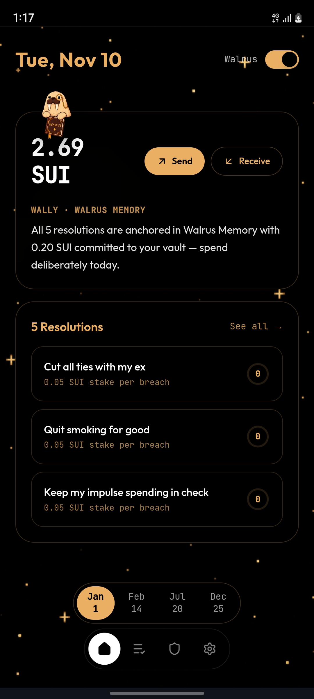

# Yearbound

An enforcing Sui wallet powered by **[Walrus Memory](https://github.com/MystenLabs/MemWal)** and **Tatum** that remembers your New Year's resolutions before a bad transfer leaves your wallet.

*"It is already the end of the year. What a year it has been. New year always meant 'new me,' yet when I checked my resolutions, I could not even 'recall' them. I bought junk and overspent anyway. Everyone (yes, including you) falls for it, so I said, let me fix it."*

Every January, millions of people make New Year's resolutions, and by February most have already quit. Yearbound tackles that by putting accountability directly inside your Sui wallet using **Walrus Memory** and **Tatum**. You set the lines you refuse to cross for the year, write why each rule matters in your own words, and set a SUI stake for breaking it. In the background, an agent named **Wally** keeps your commitments and slip-up history in **Walrus Memory**, reads live balances, inflows, and spending velocity through **Tatum**, coaches you on your home screen, and pauses any rule-breaking transfer before it signs.

Breaking a promise does not pay the app or burn your tokens. Any penalty you choose to push through settles via **x402** into a vault locked until **December 25**, turning weak moments into forced savings for your future self.

<p align="center">
  
</p>

---

## How Wally, Walrus Memory, and Tatum work together

Wally runs as part of the wallet loop rather than a separate chatbox you have to remember to open:

1. **You set the rules and why they matter.** During setup, you record real rules (no transfers to an ex, no tobacco runs, no sports betting, spending caps, savings inflow goals), a personal note on why you care, and a SUI stake per breach.
2. **Walrus Memory holds the behavioral history.** Yearbound stores structured `commitment_rule`, `genesis_pact`, `accountability_event`, and `behavioral_pattern` entries via `@mysten-incubation/memwal`. When you open the app on a browser session, return to the home tab, or start a transfer, Wally recalls your active pact, prior slip-ups, and repeated excuses.
3. **Tatum watches the chain and settles real transactions.** Yearbound queries Tatum's Sui GraphQL Gateway (`sui-mainnet.gateway.tatum.io/graphql`, with Sui public GraphQL failover) for live SUI balances, recent transfer velocity, and 30-day inflows, and builds/executes Programmable Transaction Blocks (PTBs) on Mainnet and Testnet.
4. **Wally intervenes at Send.** Every outbound transfer requires a memo explaining what the money is for. Wally recalls Walrus Memory and pulls live Tatum account metrics in parallel, then evaluates the memo, recipient, amount, and hour against your rules.
5. **Cancel at 0 SUI or forfeit an escalated fine.** If a transfer breaks a rule, the wallet pauses on the **Hold On** screen and quotes your own reason back to you. **Cancel & Honor** walks away at 0 cost. **Proceed anyway** triggers an HTTP `402 Payment Required` x402 penalty settlement (escalating `1x -> 1.5x -> 2x -> 2.5x` on repeat offenses), logs the breach and any recurring pattern to Walrus Memory, and locks the fine until Dec 25.

| Flow step | What happens | Code |
|---|---|---|
| Pact onboarding | Parses plain-English rules + motivations (`analyzeMultipleResolutions`) and writes `commitment_rule` + `genesis_pact` blobs to Walrus Memory | [`app/api/walrus/route.ts`](app/api/walrus/route.ts), [`lib/ai-resolution-parser.ts`](lib/ai-resolution-parser.ts) |
| Home screen coaching | Hydrates rules, events, and patterns from Walrus (`hydrate`), syncs balance and 30-day inflows from Tatum, and generates Wally's contextual check-in | [`app/api/wally-briefing/route.ts`](app/api/wally-briefing/route.ts), [`app/api/walrus/hydrate/route.ts`](app/api/walrus/hydrate/route.ts), [`app/api/sui/balance/route.ts`](app/api/sui/balance/route.ts) |
| Pre-send audit | Races Tatum balance/velocity checks and Walrus `recall()` in parallel, evaluates intent via Gemini structured output (with semantic category fallback), and records repeat `behavioral_pattern` entries | [`app/api/verify-transaction/route.ts`](app/api/verify-transaction/route.ts), [`lib/wally-synthesizer.ts`](lib/wally-synthesizer.ts) |
| x402 penalty & send | Issues HTTP `402` challenge (`createX402Challenge`), verifies Ed25519 signature (`X-PAYMENT`) or wallet extension digest, settles vault PTB via Tatum Gateway, then broadcasts the transfer | [`lib/vault-x402.ts`](lib/vault-x402.ts), [`app/api/vault/route.ts`](app/api/vault/route.ts), [`app/api/sui-transfer/route.ts`](app/api/sui-transfer/route.ts) |
| Walrus switch | Turning **Walrus** off in the home header disables Walrus recall/inscription and Tatum audits so you can test the wallet in stateless mode with zero enforcement | [`app/page.tsx`](app/page.tsx) |

### Memory model in Walrus

Yearbound writes four typed JSON structures into your configured Walrus Memory namespace (`WALRUS_NAMESPACE`):

- `genesis_pact` — links the wallet address, unlock date (`2026-12-25`), initial pledge, and all active rule blob IDs.
- `commitment_rule` — stores the rule title, condition, category, penalty SUI, keywords, and the user's `why_it_matters` quote.
- `accountability_event` — logs each honored or broken transfer with memo, amount, recipient, timestamp, repeat count, and on-chain digest or voucher reference.
- `behavioral_pattern` — written automatically after repeat infractions (`repeatCount >= 2`) so Wally spots recurring habits on future sends.

When `WALRUS_DELEGATE_KEY` and `WALRUS_ACCOUNT_ID` are omitted locally, [`lib/walrus.ts`](lib/walrus.ts) falls back to `MemWalMock` so the app remains runnable without credentials.

---

## Account modes

Yearbound supports three wallet modes during onboarding and via browser/Walrus restore on the sign-in screen:

| Mode | Network | Balances & settlement behavior |
|---|---|---|
| Demo account | Sui Testnet | Generates a local Testnet Ed25519 keypair, claims Testnet SUI automatically via the v3 Proof-of-Work faucet ([`app/api/sui/faucet/route.ts`](app/api/sui/faucet/route.ts)), supports the **Time-Travel Scrubber** (`Jan 1 -> Feb 14 -> Jul 20 -> Dec 25`) and Dec 25 unlock preview, and falls back to cryptographic intent vouchers if the Testnet wallet has 0 SUI. |
| Real account | Sui Mainnet | Generates a self-custodial Mainnet Ed25519 burner keypair stored in browser storage (with export + **Restore from this browser**). Starts at `0.00 SUI` balance and `0.00 SUI` vault. Refuses synthetic fallbacks: every send and x402 fine requires live Tatum solvency (`transfer + penalty + 0.005 SUI` gas buffer) and returns a verified Base58 Mainnet transaction digest. |
| Linked wallet | Sui Mainnet | Connects an installed Sui Wallet Standard browser extension. The extension signs and executes transfers and x402 deposits directly on Mainnet, verified server-side by transaction digest. |

---

## Smart contract & security notes

- **Move vault contract ([`contracts/yearbound/sources/vault.move`](contracts/yearbound/sources/vault.move)):** Defines a shared `Vault` resource with `create_vault`, `deposit_penalty`, and `withdraw`. `withdraw` checks `tx_context::sender(ctx) == vault.owner` and `clock::timestamp_ms(clock) >= vault.unlock_timestamp_ms`, with no admin key or early-release entry point.
- **Current settlement path:** Active x402 penalty execution in [`app/api/vault/route.ts`](app/api/vault/route.ts) routes on-chain SUI PTBs directly to the configured vault escrow address (`YEARBOUND_VAULT_ADDRESS` on Mainnet, `YEARBOUND_TESTNET_VAULT_ADDRESS` on Testnet) through Tatum's GraphQL Gateway, while `getVaultState` in [`lib/tatum.ts`](lib/tatum.ts) and [`lib/agent-tools.ts`](lib/agent-tools.ts) read Move `Vault` object state when `VAULT_OBJECT_ID` is configured.
- **Key handling:** Demo and Real account keypairs live in browser `localStorage`. Treat the Real account as a small-stake spending wallet, back up the exported private key in **Settings** before clearing browser data, or connect a browser wallet extension instead.

---

## Run locally

Requirements: Node.js 20+ (Node 24+ enables native `crypto.argon2` acceleration for the Sui Testnet PoW faucet) and npm.

```bash
git clone https://github.com/chief-07/yearbound.git
cd yearbound
npm install
cp .env.example .env.local
```

Configure `.env.local`:

| Variable | Purpose |
|---|---|
| `WALRUS_ACCOUNT_ID`, `WALRUS_DELEGATE_KEY` | Walrus Memory account credentials for persistent `MemWal` storage across sessions (falls back to in-memory `MemWalMock` if unset) |
| `WALRUS_RELAYER_URL`, `WALRUS_NAMESPACE` | MemWal relayer URL (defaults to `https://relayer.memory.walrus.xyz`) and memory namespace (`yearbound`) |
| `TATUM_API_KEY`, `TATUM_SUI_GATEWAY_URL` | Tatum Sui Mainnet GraphQL key & endpoint (`https://sui-mainnet.gateway.tatum.io/graphql`), with automatic failover to public Sui GraphQL on rate-limit or upstream error |
| `GOOGLE_GENERATIVE_AI_API_KEY` | Google Gemini key (from [Google AI Studio](https://aistudio.google.com)) used for rule parsing, memo auditing, and Wally briefings (falls back to deterministic parser/auditor if unset) |
| `YEARBOUND_VAULT_ADDRESS`, `VAULT_PACKAGE_ID`, `VAULT_OBJECT_ID` | Optional custom Mainnet escrow address and deployed Move contract identifiers |
| `NEXT_PUBLIC_SUI_NETWORK`, `NEXT_PUBLIC_APP_URL` | Target network (`mainnet`) and base app URL (`http://localhost:3000`) |

Start development, run tests, and check the production build:

```bash
npm run dev     # Starts Next.js 16.4.3 dev server at http://localhost:3000
npm test        # Runs unit & API route enforcement tests (28 tests)
npm run build   # Verifies production TypeScript and Next.js build
```

---

## Project layout

```text
app/page.tsx                         Main multi-step onboarding, dashboard, Wally briefing, Send flow, and 365-day activity view
app/api/verify-transaction/route.ts  Parallel Tatum + Walrus preflight and semantic/Gemini transfer audit
app/api/wally-briefing/route.ts      Contextual home-screen Wally coaching synthesis backed by Walrus Memory
app/api/walrus/route.ts              Stores commitment rules, genesis pact manifests, events, and behavioral patterns
app/api/walrus/hydrate/route.ts      Recalls and filters user pact, rules, events, and patterns for an address
app/api/vault/route.ts               HTTP 402 x402 challenge issuer, signature verifier, and on-chain penalty settlement
app/api/sui-transfer/route.ts        Sui Testnet/Mainnet PTB builder and executor (or extension digest verification)
app/api/sui/balance/route.ts         Live SUI balance lookup via Tatum GraphQL Gateway
app/api/sui/inflow/route.ts          30-day inflow and 24-hour spending velocity queries via Tatum
app/api/sui/faucet/route.ts          Sui Testnet v3 PoW faucet claimer for Demo accounts
app/api/chat/route.ts                Streaming agent route with Walrus and vault inspection tools
lib/walrus.ts                        Walrus Memory client wrapper, retry/blob recovery, and typed payload schemas
lib/tatum.ts                         Tatum Sui GraphQL client, failover fetch, balance/inflow/velocity/vault queries, and PTB execution
lib/vault-x402.ts                    Client & server x402 challenge, Ed25519 personal-message verification, and settlement helpers
lib/real-account.ts                  Pure Mainnet solvency, vault display state, and transfer-readiness helpers
lib/wallet.ts                        Keypair management (Demo/Real) and Sui Wallet Standard extension adapter
lib/wally-synthesizer.ts             Second-person coaching intervention synthesis when offline or escalating repeat slips
lib/ai-resolution-parser.ts          Gemini + deterministic parser turning raw rules and motivations into behavioral specs
lib/agent-tools.ts                   AI SDK tool definitions for store_commitment, recall_context, record_accountability_event, and check_vault_status
components/discipline-grid.tsx       365-day activity heatmap showing clean days, breaches, and honored transfers
components/time-travel-scrubber.tsx  Demo timeline scrubber (Jan 1 -> Feb 14 -> Jul 20 -> Dec 25)
components/app-tour.tsx              Guided first-run and Hold On walkthrough tooltips
contracts/yearbound/sources/vault.move  Time-locked Sui Move escrow vault contract
tests/real-account.test.ts           Tests for Mainnet solvency buffers, zero-balance vault rules, and transfer validation
tests/api-routes.test.ts             Route-level tests for Mainnet transfers, HTTP 402 flow, and transaction verification
```

---

## License

[MIT](LICENSE)
